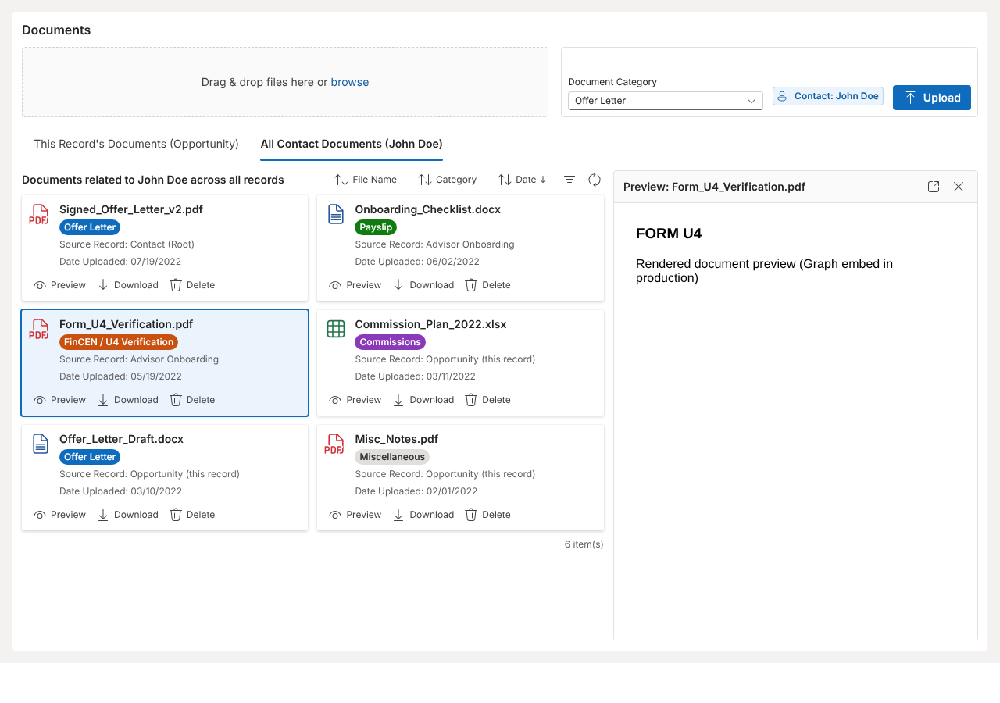

# Dynamics 365 – SharePoint Categorized Document Manager (PCF)

A Power Apps Component Framework control for Dynamics 365 model-driven apps that replaces the native
SharePoint document grid with:

- **One folder per Contact**: `/Contacts/{FullName}_{ContactGUID}/{Category folder}/`, used by every related record
  (Opportunity, Advisor Onboarding, …), instead of one folder per record.
- **Category picked at upload**, written to SharePoint metadata (`DocCategory`, `SourceEntity`, `SourceRecordId`, `ContactGuid`).
- **Two views**: *This Record's Documents* and *All Contact Documents* (across all entities).
- **Inline preview** (Graph `driveItem: preview` embed), download, and **Copy link** (copies the file's SharePoint URL;
  if the browser blocks the clipboard, the link is shown ready to copy).
- **Delete with explicit confirmation**: a dialog shows the file, category and source, and the user must tick
  "I understand…" before Delete is enabled. The server also requires the confirmed file name
  (`X-Confirm-Delete`) and refuses to delete folders.
- **Indicators & counts**: document counts on both tabs, category filter chips with counts, "Showing X of Y · size"
  in the footer, per-byte upload progress ("Uploading 2 of 3 · 45%"), a refresh bar, and "New" badges on files just
  uploaded.
- **Resilient loading**: card skeletons while loading, timeouts on every call with a Retry banner, and duplicate
  calls are skipped while Dynamics repeatedly calls `updateView`. Upload is locked on the first click.
- Drag-and-drop multi-file upload. Large files use resumable Graph upload sessions that retry throttling and resume
  after timeouts without re-sending data.
- **File safety:** executables, scripts and macro-enabled files are blocked, files whose content doesn't match
  their extension are rejected, names are sanitised, the stored size is verified, and only https
  Microsoft/SharePoint URLs reach the browser.



## Before you start (summary of [PREREQUISITES.md](docs/PREREQUISITES.md))

- **SharePoint:** a `Contacts` library on `/sites/AdvisorManagement` with text columns **`DocCategory`**,
  **`SourceEntity`**, **`SourceRecordId`** and **`ContactGuid`**. These are the exact internal names. `DocCategory`, `SourceRecordId` and `ContactGuid` are
  indexed, and none of the four is required. Check-out and content approval must be **off**. The backend app needs
  Sites.Selected **Write** on the site. `sharepoint/Setup-ContactsLibrary.ps1` sets this up and
  `Test-ContactsLibrary.ps1` verifies it.
- **Dynamics 365:** a model-driven app; Opportunity (uses the OOB `parentcontactid` lookup); an **Advisor Onboarding**
  table with a **lookup to Contact**; the lookup placed on each main form **twice** (once editable, once with the
  control); users need Read on Contact.
- **Dataverse configuration:** run `node dataverse/provision.mjs all --org <url>` as a System Administrator
  (configuration tables, environment variables, **Document Manager Reader** role, seed data).
- **Entra ID:** a backend app (`Sites.Selected` + exposed `user_impersonation` scope) and an SPA client app with a
  redirect URI for every D365 org URL.
- **Azure:** a Function App (Node 20, Functions v4) with Key Vault for the secret and CORS for the org URLs.

## Repository layout

| Path | What |
|---|---|
| `pcf/` | The PCF control (React 16.14 + Fluent UI v9 platform libraries, TypeScript). Production bundle ≈ 330 KB / 80 KB gzipped, of which ≈ 284 KB is MSAL; React/Fluent are supplied by Dynamics and icons are inlined. |
| `backend/` | Azure Function (Node 20, TypeScript) that talks to SharePoint via Microsoft Graph with an app-only, `Sites.Selected` token |
| `dataverse/provision.mjs`, `dataverse/seed.json` | Creates the configuration tables, environment variables, role and application user in Dataverse; starting categories and tables |
| `sharepoint/Setup-ContactsLibrary.ps1` | PnP PowerShell: library columns, indexes, Sites.Selected grant |
| `docs/PREREQUISITES.md` | **Start here.** What must exist first: SharePoint columns and settings, D365 tables, lookups and forms, Entra apps, Azure, permissions |
| `docs/SETUP.md` | Step-by-step setup (Entra → SharePoint → Function → solution import → D365 tables and forms → smoke test) |
| `docs/ARCHITECTURE.md`, `docs/API_SPECS.md`, `docs/PCF_STANDARDS.md`, `docs/TROUBLESHOOTING.md` | Design, contracts, coding rules and known issues |
| `AGENTS.md` (+ `CLAUDE.md`) | Instructions for AI coding agents (Claude Code, Cursor, Copilot, Windsurf) |

## Categories and tables are configuration, not code

Categories (label, value, folder, colour, order), the tables that host the control, **each table's Contact lookup
column**, the allowed categories per table and the upload limit per table all live in Dataverse. The API connection
lives in environment variables. Admins change them in the app, with no rebuild and no SharePoint change. See
**[docs/CONFIGURATION.md](docs/CONFIGURATION.md)**. `dataverse/provision.mjs` creates the tables, environment
variables and role under your admin account, then seeds them from `dataverse/seed.json`:

| Table (seed) | Contact lookup | Categories → folders |
|---|---|---|
| `opportunity` | `parentcontactid` | Offer Letter → `Offer Letters/`, Commissions → `Commissions/`, Miscellaneous → `Miscellaneous/` |
| `ce_advisoronboarding` | `ce_recruitid` | Payslip → `Onboarding Documents/Payslips/`, Resignation Letter → `Onboarding Documents/Resignation Letters/`, FinCEN / U4 Verification → `Onboarding Documents/FinCEN_U4/`, Miscellaneous |

## Security model

- The browser never holds SharePoint/Graph credentials. The control signs the current D365 user in silently (MSAL `ssoSilent`)
  and calls the Function with a user token for the backend's own API scope.
- The Function verifies that token in code (signature against the tenant's keys, issuer, audience, expiry, tenant and an
  optional app role). It does not rely on the App Service Authentication header, which can be forged if that setting is off.
- The Function calls Graph app-only with **Sites.Selected**, so it can write only to the AdvisorManagement site.
- 🔒 **Per-record security:** every operation is checked in Dataverse **as the user** (On-Behalf-Of), so their D365 roles
  decide. They must be able to read the contact to see its documents. Documents from records they can't read are
  hidden. Upload and delete need write access to the record, and an upload's record must actually belong to the
  contact. See docs/ARCHITECTURE.md §6.

## Develop

```bash
cd pcf && npm install && npm run build      # control
cd backend && npm install && npm test       # backend + unit tests
cd backend && cp local.settings.sample.json local.settings.json && npm start   # needs Azure Functions Core Tools
```

See **[docs/PREREQUISITES.md](docs/PREREQUISITES.md)** first, then **[docs/SETUP.md](docs/SETUP.md)**.

## License

[MIT](LICENSE) © 2026 Yashtech21.

Third-party notice: the SVG icon paths in `pcf/CategorizedDocManager/components/Icons.tsx` are copied from
[`@fluentui/react-icons`](https://github.com/microsoft/fluentui-system-icons) (MIT License, © Microsoft Corporation).
